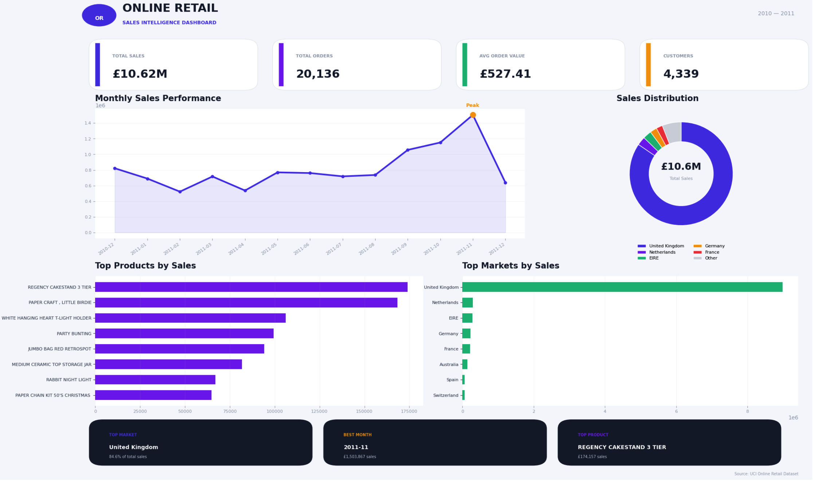

# Online Retail Sales Analysis 📊

## Project Overview

This project analyzes online retail transaction data to understand sales performance, customer behavior, product performance, and market distribution.

The analysis was performed using Python, Pandas, NumPy, and Matplotlib.

---

## Dataset

The dataset is the **Online Retail** dataset from the UCI Machine Learning Repository.

It contains transactions from a UK-based online retail business between December 2010 and December 2011.

The dataset includes information such as:

- Invoice number
- Product code
- Product description
- Quantity
- Invoice date
- Unit price
- Customer ID
- Country

**Source:** UCI Machine Learning Repository  
https://archive.ics.uci.edu/dataset/352/online%2Bretail

---

## Data Cleaning

The dataset was cleaned and prepared for analysis by:

- Handling missing values
- Removing invalid transactions
- Filtering invalid quantities and prices
- Removing cancelled transactions
- Creating a `Sales` column
- Creating a `Month` column
- Preparing the data for sales analysis

---

## Key Performance Indicators

| KPI | Value |
|---|---:|
| Total Sales | £10.62M |
| Total Orders | 20,136 |
| Average Order Value | £527 |
| Total Customers | 4,339 |

---

## Analysis

The project analyzes:

### 📈 Monthly Sales
Sales performance was analyzed across the available months to identify trends and high-performing periods.

### 🏆 Top Products
The highest-selling products were identified based on total sales.

### 🌍 Sales by Country
Sales were compared across different countries.

The United Kingdom generated approximately **84.6% of total sales**.

### 👥 Customer Analysis
Customers were ranked according to their total purchase value to identify the highest-value customers.

---
## Dashboard

The project includes a sales dashboard presenting:

- Total Sales
- Total Orders
- Average Order Value
- Total Customers
- Monthly Sales Trend
- Sales Distribution by Country
- Top Products
- Key Business Insights



---

## Tools & Technologies

- Python
- Pandas
- NumPy
- Matplotlib
- Jupyter Notebook
- GitHub

---

## Project Structure

```text
online-retail-sales-analysis/
│
├── Online_Retail_Sales_Analysis.ipynb
├── README.md
└── dashboard.png

Key Insights
- The United Kingdom is the dominant market, contributing approximately 84.6% of total sales.
- November 2011 recorded the highest monthly sales in the analyzed data.
- Product-level analysis highlights the products generating the highest revenue.
- Customer analysis identifies high-value customers based on total purchase value.
Author
Jaida Amriyah
AI Student | Python | Machine Learning | Data Analysis | AI Projects
